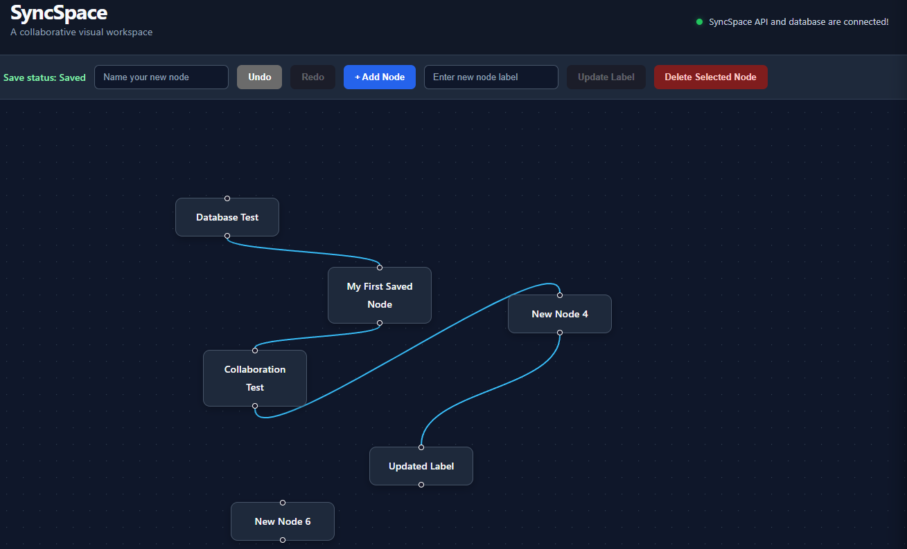

# SyncSpace

**A real-time collaborative visual workspace for building and editing diagrams together.**

SyncSpace is a full-stack web application that allows users to create, edit, and organize visual workflows on an interactive canvas. Board changes are persisted in PostgreSQL, while Socket.IO enables real-time communication between connected clients.

🌐 **Live Demo:** https://syncspace-2f6.pages.dev

🔗 **GitHub Repository:** https://github.com/kiran7593/syncspace

## Features

- **Interactive canvas:** Create nodes and connect them with edges.
- **Node editing:** Add nodes, update labels, select elements, and delete nodes.
- **Real-time collaboration:** Synchronize board changes between connected clients using Socket.IO.
- **Database persistence:** Store and retrieve board data using PostgreSQL.
- **Undo and redo:** Reverse or restore recent board changes.
- **Snap to grid:** Keep the workspace organized.
- **Automatic reconnection:** Reconnect to the backend and rejoin the collaboration room.
- **Docker support:** Run the frontend, backend, and database using Docker Compose.
- **Responsive interface:** Work with the visual workspace across different screen sizes.

## Tech Stack

| Category | Technologies |
|---|---|
| Frontend | React, TypeScript, Vite |
| Visual editor | React Flow (`@xyflow/react`) |
| Backend | Node.js, Express |
| Real-time communication | Socket.IO |
| Database | PostgreSQL |
| Containerization | Docker, Docker Compose |
| Deployment | Cloudflare Pages, Render, Neon PostgreSQL |
| Version control | Git, GitHub |

## Architecture

SyncSpace uses a client-server architecture:

1. The React frontend provides the interactive diagram editor.
2. The Express backend exposes API endpoints and handles application requests.
3. Socket.IO manages real-time communication between connected clients.
4. PostgreSQL stores board data, including nodes and connections.
5. Docker Compose coordinates the local frontend, backend, and database services.

### Data Flow

- A user makes a change to the visual board.
- The frontend communicates the change to the backend.
- The backend persists the updated board in PostgreSQL.
- Socket.IO broadcasts updates to other connected clients.
- Connected clients receive the changes and update their boards.

## Screenshots



## Live Application

The application is deployed using:

- **Frontend:** Cloudflare Pages
- **Backend:** Render
- **Database:** Neon PostgreSQL

Live URL: https://syncspace-2f6.pages.dev

The backend runs on Render's free tier, so the first request after a period of inactivity may take longer while the service starts.

## Run Locally

### Prerequisites

- Node.js and npm
- Docker Desktop
- Git

### 1. Clone the repository

```bash
git clone https://github.com/kiran7593/syncspace.git
cd syncspace
```

### 2. Configure environment variables

Create a `.env` file in the project root directory.

Add your own PostgreSQL credentials:

```env
POSTGRES_USER=your_database_user
POSTGRES_PASSWORD=your_database_password
POSTGRES_DB=syncspace
```

These variables are used by Docker Compose to configure the PostgreSQL container and backend connection.

**Important:** Keep your `.env` file private. Never commit database credentials or other secrets to GitHub.

### 3. Start the application

From the project root, run:

```bash
docker compose up -d --build
```

Docker Compose starts the PostgreSQL database, backend, and frontend. The backend waits for the database health check before starting.

### 4. Access the application

| Service | Local URL |
|---|---|
| Frontend | http://localhost:8080 |
| Backend health check | http://localhost:5000/api/health |
| PostgreSQL | localhost:5433 |

### 5. Stop the application

```bash
docker compose down
```

This stops and removes the containers but preserves the named PostgreSQL data volume.

**Important:** Avoid `docker compose down -v` unless you intentionally want to delete the persistent database volume and its data.

## Database Persistence

Board data is stored in PostgreSQL using JSONB.

The database stores the board's nodes, edges, and associated metadata. This allows the application to restore the saved workspace after refreshing the browser or restarting the services.

## What I Learned

Building SyncSpace provided practical experience with:

- Developing a full-stack application using React, TypeScript, and Express.
- Implementing real-time communication with Socket.IO.
- Designing and working with PostgreSQL persistence.
- Managing application services with Docker Compose.
- Connecting frontend and backend services across separate deployments.
- Deploying a full-stack application using cloud hosting platforms.
- Troubleshooting database, networking, and deployment issues.

## Future Improvements

Potential enhancements include:

- User accounts and authentication.
- Multiple independent collaborative boards.
- Board sharing and access permissions.
- Improved collaboration and workspace management.

---

**Built as a portfolio project to demonstrate full-stack development, real-time communication, database integration, and deployment skills.**
